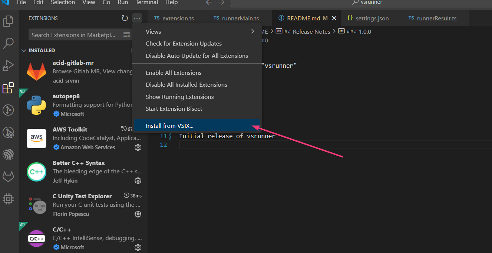

# Development

```shell
npm install
npm run compile      # or the default build task (watch)
npm test             # lint, unit tests, integration tests in VS Code
npm run icons        # re-render media/ from scripts/render-icon.mjs
```

F5 launches an Extension Development Host with `examples/basic`,
`examples/legacy` or `../wsh-iot`. The workspace tasks cover packaging,
local install and publishing.

## Publish

Publisher: `whoosh-embedded`, owned by the Whoosh Entra ID tenant. Publishing
signs in through Azure CLI, since global Personal Access Tokens stop working
on December 1, 2026:

```shell
brew install azure-cli
az login                 # an account with access to the publisher
```

Then run the **Bump and publish** task, or
`npx vsce publish patch --azure-credential && git push --follow-tags`. The
Marketplace takes a few minutes to show a new version.

Until December 2026 a PAT (dev.azure.com → User settings → Personal access
tokens, organization *All accessible organizations*, scope *Marketplace →
Manage*) also works: `npx vsce login whoosh-embedded`, then `npx vsce publish`
without `--azure-credential`.

## Install from VSIX

Run the **Install VSIX locally** task, or `npx vsce package` and
*Extensions → … → Install from VSIX*.



## Icons

See [docs/icons.md](icons.md).
