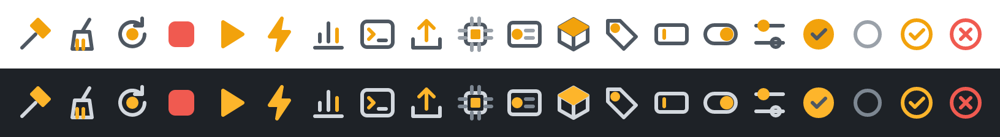

# Icon design code

Derived from the Whoosh app icon: a slate tile, a white mark, and an amber bar
running off the left edge.

## Tokens

| Token | Value | Use |
|---|---|---|
| Amber | `#FDB52B` | Accent on dark themes, marketplace bar |
| Amber deep | `#F2A20C` | Accent on light themes (plain amber washes out on white) |
| Slate | `#4E5761` | Marketplace tile; line colour on light themes; tick on a selected item |
| Fog | `#D3D8DE` | Line colour on dark themes |
| Muted | `#9AA1A9` light / `#7D8792` dark | Secondary lines, unselected items |
| Signal red | `#F05A50` | Stop and failure only |

## Glyph rules

- 16×16 grid, 1.5px stroke, round caps and joins, no fill except accents.
- One amber detail per glyph: the part that "does" something (hammer head,
  play triangle, chip core, tag hole). Everything else is the theme line colour.
- Red is reserved for stop and failure; success is the amber check.
- Selected item: filled amber disc with a slate tick. Unselected: muted ring.
- The activity bar icon is a single-colour silhouette (VS Code tints it), so it
  carries the shape only: chip outline with a play triangle.
- Status bar text cannot show custom SVGs and uses the nearest codicon.

## Marketplace icon

256×256, slate tile with 56px radius, white chip-and-play mark, amber bar
from the left edge to 212px, echoing the app icon.

## Changing icons

All glyphs live in `scripts/render-icon.mjs`, written once with `INK`, `MUTED`
and `ACC` placeholders. `npm run icons` renders both theme variants, the
activity bar icon, `media/icon.png` and the sheet above.
